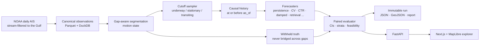

# Maritime Forecast Lab

**Where will this ship be in 1 hour, 6 hours, or 3 days?** A research workbench for forecasting vessel trajectories from AIS position reports. Its core is an evaluator built so that no forecast can see the future.

<picture>
  <source media="(prefers-color-scheme: dark)" srcset="docs/img/forecast-example-dark.png">
  
</picture>

*One real cutoff from the June 2023 test set. Every model saw only the reports up to the black square. The dotted line is what the ship actually did, withheld until scoring. Straight-line extrapolation crosses land within hours; that gap is what route-aware models should close.*

---

## What this is

Pick a vessel and a moment in the past. The workbench then:

1. **replays** only the AIS data that existed at that moment (the *cutoff*);
2. **runs one or more forecasters**: today, kinematic baselines; next, retrieval of historical routes, then foundation and learned models;
3. **reveals the real track** and scores every model on exactly the same samples, with confidence intervals, coverage gaps and feasibility (did the forecast put the ship on land?).

The same machinery runs thousands of cutoffs unattended, as a benchmark, and serves single forecasts through an API to a map-based explorer.

It is **not** a port-destination classifier and **not** (yet) a live tracker. The question is geographic: *position at a horizon*.

## Why evaluation comes first

Published AIS trajectory-prediction results are often inflated. The [calibration paper](https://arxiv.org/abs/2609.25827) behind this project shows three causes: oracle best-of-N decoding, vessels shared between train and test, and geographic overlap. Here the evaluator prevents all three by default:

| Guard | How it is enforced |
|---|---|
| **No hindsight** | A model only receives reports at or before the cutoff. The invariance test deletes, shifts, spikes and floods every report after the cutoff; every registered model must give an identical forecast. It runs on real NOAA cutoffs |
| **Named protocols** | **P-known** is a chronological split; a vessel's own earlier voyages are allowed. **P-unseen** adds vessel-disjoint assignment by MMSI hash. Fitted parameters (τ, masks, retrieval index) come only from the protocol's train split |
| **Paired scoring** | Every model in a comparison is scored on the identical set of (cutoff, horizon) samples. A model that fails on a sample is recorded as failed, never silently dropped |
| **Honest uncertainty** | Vessel-bootstrap 95% CIs. No best-of-N in any operational number. Similarity scores are labelled as similarity, not probability |
| **Real ground truth only** | Truth is interpolated only between reports ≤ 30 min apart and never bridged across a coverage gap. Horizons with too little truth are marked *experimental* per stratum |
| **Calibrated evaluator** | Constant velocity on the paper's protocol must reproduce the published numbers within 10% before any model comparison is trusted |
| **Immutable runs** | Every benchmark is write-once and checksummed, and records data provenance, protocol, sampler seed, model versions and git SHA |

## How it works



- **Cutoff region:** Houston–Galveston.
- **Truth region:** the whole U.S. Gulf coast, so a ship that leaves the port box is still scored.
- **Cutoffs:** sampled by motion state with per-vessel caps. Port AIS is dominated by moored ships and tugs, so uniform sampling would measure the wrong thing.

## What the baselines show so far

All numbers come from immutable runs on the June 2023 NOAA test period (Jun 23–30); run ids and checksums are in [docs/benchmarks.md](docs/benchmarks.md). "Transiting" means cargo, tanker and passenger ships that have been underway for the last 30 minutes. The evaluator itself is calibrated: paper-mode constant velocity gives 4.03 / 9.65 / 16.16 km at 1 / 2 / 3 h against the published 3.69 / 9.03 / 15.33 km (+9% / +7% / +5%, within the 10% tolerance).

<picture>
  <source media="(prefers-color-scheme: dark)" srcset="docs/img/error-by-horizon-dark.png">
  
</picture>

- **Up to 3 h, constant velocity wins:** 4.2 km median at 1 h for ships in transit.
- **From 6 h, damped velocity is the bar to beat:** speed decays exponentially, with τ fitted per vessel class on the train split. It settles around 33–37 km, against 53–62 km for persistence; CIs exclude zero under both protocols.

<picture>
  <source media="(prefers-color-scheme: dark)" srcset="docs/img/on-land-dark.png">
  
</picture>

- **Kinematics leave the channel.** In port, 61% of constant-velocity forecasts are on land within an hour.
  - The navigable-water mask is OSM land minus water cells that training-period traffic actually used. That matters because OpenStreetMap's land polygons treat the ship channel itself as land.
  - Its own error is measured on the true positions and reported in every cell (dashed line).

The success condition for every later model is the same: **beat the best of persistence, constant velocity and damped velocity, per stratum, on paired held-out samples under P-known and P-unseen**. If that doesn't happen, the dashboard says so.

## Roadmap

| # | Milestone | Status |
|---|---|---|
| 0 | Data spike & coverage audit: what horizons can the data support? | ✓ |
| 1 | Contracts, data pipeline, read API, track explorer, CI | ✓ |
| 2 | Baselines & the evaluator: paired benchmark, calibration, invariance, feasibility, benchmark API | ✓ |
| 3 | **Historical-route retrieval:** kNN over train-period segments, aligned and continued along real routes | ← *now* (segment index done) |
| 4 | Conformal uncertainty: calibrated displacement radii per stratum | |
| 5 | Workbench UI: forecast comparison, truth overlay, benchmark dashboard | |
| 6 | Timestral zero-shot adapter (position, velocity, velocity + retrieved route) | |
| 7 | Research models: TrAISformer via the calibration paper's reimplementation | |
| 8 | Multi-day credibility with longer-range AIS; optional live ingest | |

Full specification: [docs/build-plan.md](docs/build-plan.md). Progress, decisions and every command run: [docs/implementation-log.md](docs/implementation-log.md).

## Quick start

Requires [uv](https://docs.astral.sh/uv/) (it installs Python 3.12) and Node 24 for the web app.

```bash
make setup                        # Python env + frontend node_modules
make test                         # unit tests (no network, no data)
make dev                          # API on :8000 (docs at /docs) + web app on http://localhost:3000
```

With data (about 10 GB downloaded, filtered on the fly to about 1 GB of Gulf data):

```bash
make fetch && make canonical      # NOAA June 2023 -> canonical observations
make splits                       # P-known / P-unseen / P-paper manifests
make calibrate                    # evaluator vs published numbers + real-data golden tests
make fit PROTOCOL=P-known         # damped-velocity tau on the train split
make fetch-land && make mask PROTOCOL=P-known   # navigable-water mask for feasibility
make benchmark PROTOCOL=P-known   # unattended paired benchmark -> immutable run + GeoJSON
make index                        # retrieval segment index (Milestone 3)
```

The API serves datasets, vessels and tracks, `POST /forecasts`, `POST /forecasts/evaluation` (truth only after the forecast exists), and `POST /benchmarks` with status and summary endpoints. See [docs/architecture.md](docs/architecture.md).

## Repository layout

| Path | Contents |
|---|---|
| `backend/src/maritime_forecast/` | The package: `data/` (ingest, segmentation, cutoffs, segment index), `models/`, `evaluation/` (runner, truth, bootstrap, feasibility, invariance), `geo/`, `api/`, `schemas/` |
| `scripts/` | Thin CLIs: fetch, canonicalize, audit, calibrate, fit, benchmark, masks, index, figures |
| `frontend/` | Next.js + MapLibre explorer (tracks with gaps drawn as gaps) |
| `config/` | Regions and provider column mappings (no hardcoded coordinates) |
| `docs/` | Spec, coverage audit, evaluation protocol, benchmarks, implementation log |
| `data/` | Gitignored except the committed manifests (the provenance record) |

## Data and licensing

- **AIS:** [NOAA MarineCadastre AccessAIS](https://coast.noaa.gov/digitalcoast/tools/ais.html), U.S. Coast Guard terrestrial AIS, one-minute filtered. Public domain. Static fields such as vessel type are back-filled by NOAA and treated as non-as-of. Other providers import through column mappings; one day of Danish Maritime Authority AIS is verified.
- **Land polygons and basemap:** © [OpenStreetMap](https://www.openstreetmap.org/copyright) contributors (ODbL), via [osmdata.openstreetmap.de](https://osmdata.openstreetmap.de) and [OpenFreeMap](https://openfreemap.org).
- **Code:** MIT. Data and third-party models carry their own licenses; see [data/README.md](data/README.md).

The README figures are produced by `scripts/make_readme_figures.py` from the runs cited above. No vessel identities are shown.

## Working on this repo with coding agents

[`AGENTS.md`](AGENTS.md) holds the binding rules: milestones in order, leakage invariants, never best-of-N, paired scoring only. `CLAUDE.md` files describe each directory. Project skills live in `.claude/skills/`, and a leakage-review subagent in `.claude/agents/` reviews every evaluator, sampler, retrieval or model change before it is committed.
