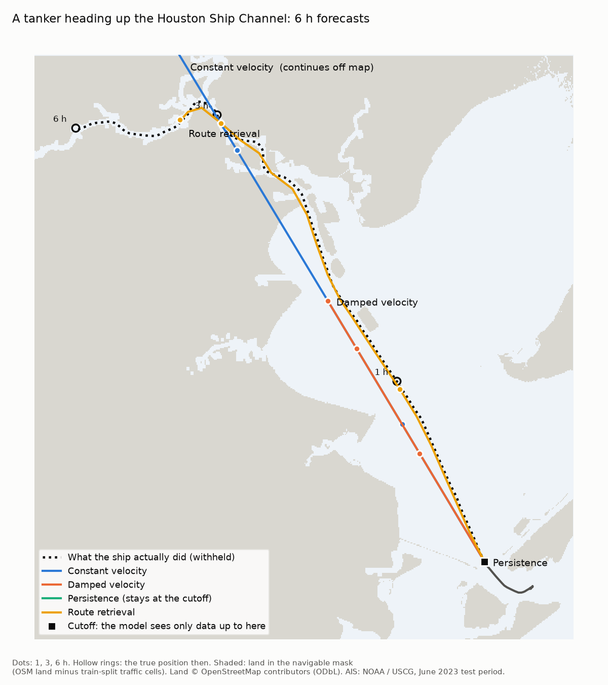
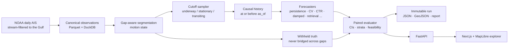
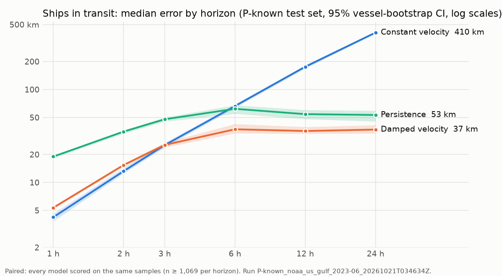
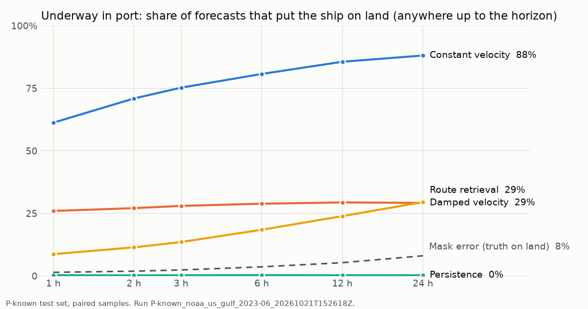

# Maritime Forecast Lab

**Where will this ship be in 1 hour, 6 hours, or 3 days?** A research workbench for forecasting vessel trajectories from AIS position reports. Its core is an evaluator built so that no forecast can see the future.

<picture>
  <source media="(prefers-color-scheme: dark)" srcset="docs/img/forecast-example-dark.png">
  
</picture>

*One real cutoff from the July 2023 hold-out, chosen by a fixed rule (the transiting tanker cutoff nearest Bolivar Roads), not by its errors. Every model saw only the reports up to the black square. The dotted line is what the ship actually did, withheld until scoring. The kinematic forecasts carry on along the last heading and cross land. Route retrieval follows earlier ships into the channel and stays close to the real track for 6 h.*

---

## What this is

Pick a vessel and a moment in the past. The workbench then:

1. **replays** only the AIS data that existed at that moment (the *cutoff*);
2. **runs one or more forecasters**: kinematic baselines and retrieval of historical routes today; foundation and learned models next;
3. **reveals the real track** and scores every model on exactly the same samples, with confidence intervals, coverage gaps and feasibility (did the forecast put the ship on land?).

The same machinery runs thousands of cutoffs unattended, as a benchmark, and serves single forecasts through an API to a map-based explorer.

It is **not** a port-destination classifier and **not** (yet) a live tracker. The question is geographic: *position at a horizon*.

## Why evaluation comes first

Published AIS trajectory-prediction results are often inflated. The [calibration paper](https://arxiv.org/abs/2609.25827) behind this project shows three causes: oracle best-of-N decoding, vessels shared between train and test, and geographic overlap. Here the evaluator prevents all three by default:

| Guard | How it is enforced |
|---|---|
| **No hindsight** | A model only receives reports at or before the cutoff. The invariance test deletes, shifts, spikes and floods every report after the cutoff; every registered model must give an identical forecast. It runs on real NOAA cutoffs |
| **Named protocols** | **P-known** is a chronological split; a vessel's own earlier voyages are allowed. **P-unseen** adds vessel-disjoint assignment by MMSI hash. Fitted parameters (τ, masks, retrieval index) come only from the protocol's train split |
| **Paired scoring** | Every model in a comparison is scored on the identical set of (cutoff, horizon) samples. A model that fails on a sample is recorded as failed, never silently dropped |
| **Honest uncertainty** | Vessel-bootstrap 95% CIs. No best-of-N in any operational number. Similarity scores are labelled as similarity, not probability |
| **Real ground truth only** | Truth is interpolated only between reports ≤ 30 min apart and never bridged across a coverage gap. Horizons with too little truth are marked *experimental* per stratum |
| **Calibrated evaluator** | Constant velocity on the paper's protocol must reproduce the published numbers within 10% before any model comparison is trusted |
| **Immutable runs** | Every benchmark is write-once and checksummed, and records data provenance, protocol, sampler seed, model versions and git SHA |

## How it works



- **Cutoff region:** Houston–Galveston.
- **Truth region:** the whole U.S. Gulf coast, so a ship that leaves the port box is still scored.
- **Cutoffs:** sampled by motion state with per-vessel caps. Port AIS is dominated by moored ships and tugs, so uniform sampling would measure the wrong thing.

## Results so far

Headline numbers come from the **July 2023 hold-out** (Jul 2–30).
- **Untouched until scored:** no model was designed or tuned on July. Each model version was scored on it once, and the code enforces and logs this (`data/manifests/test_access/`).
- **Earlier results:** the June test results that shaped the current models are kept in [docs/benchmarks.md](docs/benchmarks.md) with every run id and checksum, and they show the same pattern.
- **Skill** is the paired reduction in median error against the best of persistence, constant velocity and damped velocity in that cell, with a 95% vessel-bootstrap CI.
- **Transiting** means cargo, tanker and passenger ships that have been underway for the last 30 minutes.
- **The evaluator itself is calibrated:** paper-mode constant velocity gives 4.03 / 9.65 / 16.16 km at 1 / 2 / 3 h, against the published 3.69 / 9.03 / 15.33 km (+9% / +7% / +5%, within the 10% tolerance).

### Historical-route retrieval beats every baseline for ships in transit, on held-out data

**How retrieval works.** It finds the training-period voyages that passed closest to the ship's current position on a similar course, speed and recent track. It lines them up at the ship and follows the closest match forward. It has no learned parameters, and it uses only voyages completed before the training period ended (Jun 17).
- **v2 vs v1:** v2 ([notes](docs/model-integration-notes.md)) differs from v1 in one way. A ship that is moored at the cutoff stays put.
- **Under way, v1 and v2 are identical.**

<picture>
  <source media="(prefers-color-scheme: dark)" srcset="docs/img/error-by-horizon-dark.png">
  
</picture>

Ships in transit, July hold-out, median error in km (best baseline in brackets):

| Horizon | P-known retrieval | Best baseline | Skill [95% CI] | P-unseen retrieval | Best baseline | Skill [95% CI] |
|---|---|---|---|---|---|---|
| 1 h | **1.7** | 4.3 (CV) | +60% [57, 63] | **2.0** | 4.6 (CV) | +57% [50, 63] |
| 3 h | **6.0** | 24.5 (CV) | +76% [74, 77] | **7.2** | 24.2 (CV) | +70% [67, 75] |
| 6 h | **13.4** | 38.2 (damped) | +65% [61, 68] | **16.3** | 40.4 (damped) | +60% [51, 67] |
| 12 h | **20.2** | 36.0 (damped) | +44% [39, 48] | **21.8** | 38.9 (damped) | +44% [32, 52] |
| 24 h | **25.4** | 36.1 (damped) | +30% [19, 37] | **24.7** | 38.8 (damped) | +36% [13, 47] |

- **Sample sizes:** P-known has 4,590–6,006 paired samples per horizon from about 950 vessels; P-unseen has 781–1,063 from about 185.
- **P-unseen caveat:** its July test vessels are the same vessels as in June, so the result is fresh in time but not in vessels.

**Where it does not win:**
- **All underway traffic (mostly tugs and harbour craft):**
  - P-known: wins up to 6 h (+53% at 1 h, +19% at 6 h), ties at 12 h and **loses at 24 h** (−31% [−39, −23] against persistence).
  - P-unseen: wins up to 3 h, ties at 6 h, and **loses at 12 h (−17%) and 24 h (−44%)**.
  - Short, irregular harbour jobs are poorly matched by other ships' tracks over a day.
- **Moored and anchored vessels:**
  - v1 lost badly here (median 4.4 km against persistence's 0.35 km at 24 h): a nearby ship that later left dragged the forecast away.
  - v2 holds a moored ship in place, so on these vessels **it is persistence and ties it by construction**. Retrieval does not predict departures.
- **New waters:** under P-region (train elsewhere in the Gulf, test in Houston), retrieval has no historical route nearby and fails on every cutoff. The kinematic baselines, which need no geography, still work there.
- **References run out:** most historical segments end within hours, when the reference ship leaves receiver coverage. After that the forecast holds the reference's last position, which is why the advantage shrinks with horizon.

<picture>
  <source media="(prefers-color-scheme: dark)" srcset="docs/img/on-land-dark.png">
  
</picture>

- **Kinematics leave the channel.** In port, 58% of constant-velocity forecasts are on land within an hour.
- **Retrieval mostly stays in water:** 8% of its paths have a point on land by 1 h, 30% by 24 h.
  - Its *path* crossing rate is higher (27% at 1 h): straight 10-minute chords between points cut the bends of narrow channels.
- **The mask:** the navigable-water mask is OSM land minus water cells that training-period traffic actually used, because OpenStreetMap's land polygons treat the ship channel itself as land.
  - Its own error is measured on the true positions and reported in every cell (dashed line).

### Calibrated uncertainty radii (Milestone 4, first slice)

**What the radii are:**
- Each forecast can carry a split-conformal radius. Over forecasts like the calibration samples, at least 90% of true positions should fall within *r* km of the forecast point. That is a marginal coverage claim that assumes exchangeability, not a probability for one particular ship.
- It is fitted per model, horizon and stratum on a calibration window (Jun 23–30) that the models never trained on.
- `POST /forecasts` returns the radii at the fitted horizons (1/2/3/6/12/24 h), with the calibration run id and sample sizes. It returns them only for forecasts that resemble the calibration samples; otherwise it says why not.
- No per-axis marginal intervals are ever combined into a corridor.

**Coverage on the July hold-out, P-known:**
- 69 of 72 motion-level cells cover within ±3 points of 90%. Retrieval's 90% radius for a ship in transit is 12.7 km at 1 h (89.6% coverage), against 12.4 km for damped velocity.
- At equal coverage, retrieval's radius discs are smaller than damped velocity's up to 12 h (529 vs 724 km² at 1 h).
- **Retrieval's coverage slips through July** (90.1% → 86.8% at 1 h by the third week), because its reference voyages get older.
- **P-unseen is not calibrated for underway traffic** (79–89% at a nominal 90%). Its calibration bucket is only 5% of the vessels.

- **H3 bins tried and rejected:** a pre-registered variant gave each H3 hexagon (about 250 km²) its own radius. It shrank v2's mean disc area at every horizon (by 6–13% under P-known, 4–8% under P-unseen), but broke calibration for retrieval under P-known (61/72 cells against 69/72), so it was not adopted.

Details: [docs/benchmarks.md](docs/benchmarks.md).

The success condition for every model is the same: **beat the best of persistence, constant velocity and damped velocity, per stratum, on paired held-out samples under P-known and P-unseen.** Retrieval meets it for ships in transit at every horizon under both protocols, and for all underway traffic up to 3–6 h. It does not meet it for long-horizon harbour traffic. For moored vessels, v2 only ties persistence.

## Roadmap

| # | Milestone | Status |
|---|---|---|
| 0 | Data spike & coverage audit: what horizons can the data support? | ✓ |
| 1 | Contracts, data pipeline, read API, track explorer, CI | ✓ |
| 2 | Baselines & the evaluator: paired benchmark, calibration, invariance, feasibility, benchmark API | ✓ |
| 3 | Historical-route retrieval: kNN over train-period segments, aligned and continued along real routes ([failure review](docs/failure-review.md)); v2 holds moored ships; scored on the July hold-out | ✓ |
| 4 | Conformal uncertainty: calibrated displacement radii per stratum, served by the API (H3 bins tried, not adopted) | ✓ |
| 5 | Workbench UI: forecast comparison, truth overlay, benchmark dashboard, failure gallery with sample replay, Playwright smoke test | ✓ |
| 6 | Timestral zero-shot adapter (position, velocity, context length): closed as a negative result on the dev window; it never beat retrieval or, on transiting ships, the best kinematic baseline ([notes](docs/model-integration-notes.md)) | ✗ closed |
| 7 | **Hex prediction sets:** a calibrated set of H3 cells per horizon ("which hexes will the ship be in?"), built on historical traffic | ← next |
| 8 | Research models: TrAISformer via the calibration paper's reimplementation, scored as a distribution | |
| 9 | Multi-day credibility with longer-range AIS; optional live ingest | |

Full specification: [docs/build-plan.md](docs/build-plan.md). Progress, decisions and every command run: [docs/implementation-log.md](docs/implementation-log.md).

## Quick start

Requires [uv](https://docs.astral.sh/uv/) (it installs Python 3.12) and Node 24 for the web app.

```bash
make setup                        # Python env + frontend node_modules
make test                         # unit tests (no network, no data)
make dev                          # API on :8000 (docs at /docs) + web app on http://localhost:3000
```

With data (about 10 GB downloaded, filtered on the fly to about 1 GB of Gulf data):

```bash
make fetch && make canonical      # NOAA June 2023 -> canonical observations
make splits                       # P-known / P-unseen / P-paper manifests
make calibrate                    # evaluator vs published numbers + real-data golden tests
make fit PROTOCOL=P-known         # damped-velocity tau on the train split
make fetch-land && make mask PROTOCOL=P-known   # navigable-water mask for feasibility
make benchmark PROTOCOL=P-known   # unattended paired benchmark -> immutable run + GeoJSON
make index                        # prebuilt retrieval segment index (the model builds its own pool)
```

The API serves datasets, vessels and tracks, `POST /forecasts`, `POST /forecasts/evaluation` (truth only after the forecast exists), and `POST /benchmarks` with status and summary endpoints. See [docs/architecture.md](docs/architecture.md).

## Repository layout

| Path | Contents |
|---|---|
| `backend/src/maritime_forecast/` | The package: `data/` (ingest, segmentation, cutoffs, segment index), `models/`, `evaluation/` (runner, truth, bootstrap, feasibility, invariance), `geo/`, `api/`, `schemas/` |
| `scripts/` | Thin CLIs: fetch, canonicalize, audit, calibrate, fit, benchmark, masks, index, figures |
| `frontend/` | Next.js + MapLibre explorer (tracks with gaps drawn as gaps) |
| `config/` | Regions and provider column mappings (no hardcoded coordinates) |
| `docs/` | Spec, coverage audit, evaluation protocol, benchmarks, implementation log |
| `data/` | Gitignored except the committed manifests (the provenance record) |

## Data and licensing

- **AIS:** [NOAA MarineCadastre AccessAIS](https://coast.noaa.gov/digitalcoast/tools/ais.html), U.S. Coast Guard terrestrial AIS, one-minute filtered. Public domain. Static fields such as vessel type are back-filled by NOAA and treated as non-as-of. Other providers import through column mappings; one day of Danish Maritime Authority AIS is verified.
- **Land polygons and basemap:** © [OpenStreetMap](https://www.openstreetmap.org/copyright) contributors (ODbL), via [osmdata.openstreetmap.de](https://osmdata.openstreetmap.de) and [OpenFreeMap](https://openfreemap.org).
- **Code:** MIT. Data and third-party models carry their own licenses; see [data/README.md](data/README.md).

The README figures are produced by `scripts/make_readme_figures.py` from the runs cited above. No vessel identities are shown.

## Working on this repo with coding agents

[`AGENTS.md`](AGENTS.md) holds the binding rules: milestones in order, leakage invariants, never best-of-N, paired scoring only. `CLAUDE.md` files describe each directory. Project skills live in `.claude/skills/`, and a leakage-review subagent in `.claude/agents/` reviews every evaluator, sampler, retrieval or model change before it is committed.
